  <!-- Banner animado divertido: Mario Gamer & Programmer en su setup pixel art con consolas y código -->
  

<!-- Trío de animaciones divertidas de programación -->

  
  &nbsp;&nbsp;&nbsp;&nbsp;&nbsp;&nbsp;&nbsp;&nbsp;
  
  &nbsp;&nbsp;&nbsp;&nbsp;&nbsp;&nbsp;&nbsp;&nbsp;
  

<!-- Título dinámico interactivo en estilo Neon Cyan -->

  

<!-- Insignias de estado estilo Cyberpunk / Gaming Pro -->

  
  
  
  
  

  <a href="#perfil"><code>👤 PERFIL</code></a> •
  <a href="#proyectos"><code>🚀 PROYECTOS & LOTES 3D</code></a> •
  <a href="#arsenal"><code>⚔️ ARSENAL</code></a> •
  <a href="#telemetria"><code>📊 TELEMETRÍA</code></a>

---

### 💻 PERFIL DEL DESARROLLADOR

<table>
  <tr>
    <td width="58%" valign="top">
      <h3>⚡ Antony Acosta Delgado</h3>
      
Estudiante de <b>4.° ciclo de Desarrollo de Software en SENATI</b>, apasionado por la creación de sistemas y plataformas de alto impacto. Especializado en el desarrollo de arquitecturas web modernas con <b>Next.js</b> y <b>NestJS</b>, integración de <b>Inteligencia Artificial</b> y soluciones interactivas 3D para el sector inmobiliario y comercial.

      <ul>
        <li>🎓 <b>Formación Académica:</b> SENATI — Desarrollo de Software (4to ciclo).</li>
        <li>💻 <b>Stack Core:</b> Next.js, React, NestJS, Node.js, Python, TypeScript.</li>
        <li>🗺️ <b>Innovación 3D:</b> Maquetas interactivas, lotizadores 3D y visores con Three.js.</li>
        <li>🤖 <b>IA & Visión Artificial:</b> OpenCV, Deep Learning con PyTorch y análisis con Pandas.</li>
        <li>🛠️ <b>Bases de Datos & Arquitectura:</b> PostgreSQL, MySQL, MongoDB, SQLite y Clean Architecture.</li>
      </ul>
    </td>
    <td width="42%" align="center" valign="middle">
      <!-- El gato programador tecleando rápido, con la marca de agua @aaron 100% eliminada -->
      
    </td>
  </tr>
</table>

---

### 🚀 PROYECTOS DESTACADOS : SISTEMAS INMOBILIARIOS Y 3D

| PROYECTO / SISTEMA | CATEGORÍA & ARQUITECTURA | STACK DE TECNOLOGÍAS | ESTADO |
| :--- | :--- | :--- | :---: |
| 🗺️ **Lotizador 3D & Masterplan Interactivo** | Sistema de venta de lotes en 3D con selección interactiva, cálculo de cuotas y estados (Disponible/Vendido). | `Next.js` `Three.js` `PostgreSQL` | 🟢 En Desarrollo |
| 🌐 **Sistema Web Administrativo & ERP** | Plataforma para administración de procesos de negocio, roles, facturación y contratos automatizados. | `NestJS` `React` `MySQL` | 🟢 Activo |
| 📊 **Dashboard Analítico en Tiempo Real** | Panel de monitoreo de métricas, telemetría comercial y gráficos dinámicos con procesamiento de datos. | `Python` `Pandas` `Tailwind` | 🟢 Activo |
| 🤖 **Módulo de Visión Computacional** | Reconocimiento automatizado de patrones, filtrado de imágenes y modelos de visión artificial. | `Python` `OpenCV` `PyTorch` | 🟢 En Producción |

---

### ⚔️ ARSENAL TECNOLÓGICO : STACK PROFESIONAL

<table border="0">
  <tr>
    <td align="center" width="50%">
      <h4>🌐 DESARROLLO FRONTEND & UI/UX</h4>
      
    </td>
    <td align="center" width="50%">
      <h4>⚙️ BACKEND & APIS ESCALABLES</h4>
      
    </td>
  </tr>
  <tr>
    <td align="center" width="50%">
      <h4>🤖 IA & CIENCIA DE DATOS</h4>
      
    </td>
    <td align="center" width="50%">
      <h4>🗄️ BASES DE DATOS & DEV TOOLS</h4>
      
    </td>
  </tr>
</table>

---

### 📊 TELEMETRÍA & RENDIMIENTO EN VIVO

  <!-- Racha interactiva de contribuciones oficial -->
  

 

  
  &nbsp;
  
  &nbsp;
  
  &nbsp;
  

 

  <!-- El juego de la serpiente (Snake) comiendo las contribuciones de GitHub -->
  <h4>🐍 COMMITS 🐍</h4>
  

 

  <!-- El juego de Pac-Man retro arcade en el tablero de contribuciones -->
  <h4>👾 CONTRIBUTIONS 👾</h4>
  

---

  ⚡ Perfil profesional desarrollado y optimizado para Antony Acosta Delgado • SENATI 2026 ⚡

